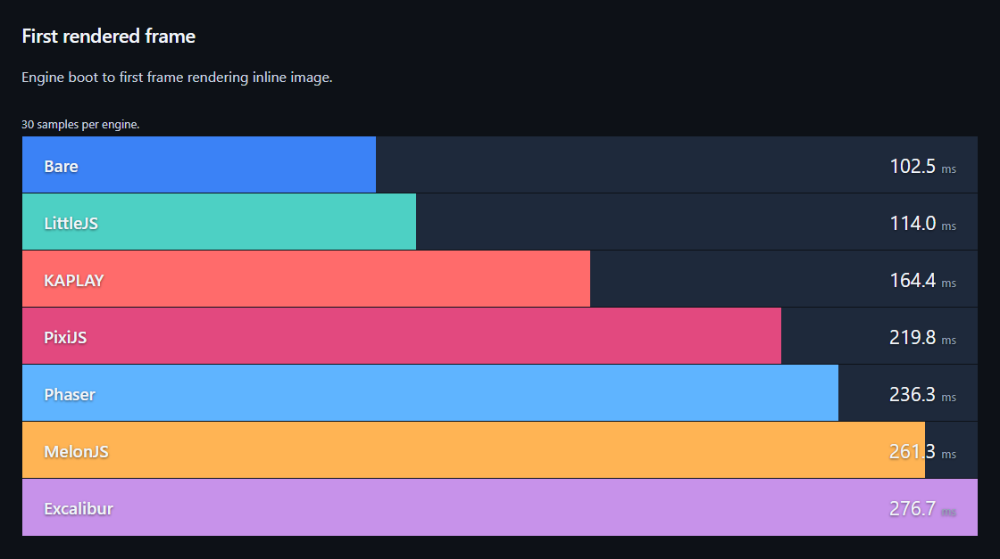
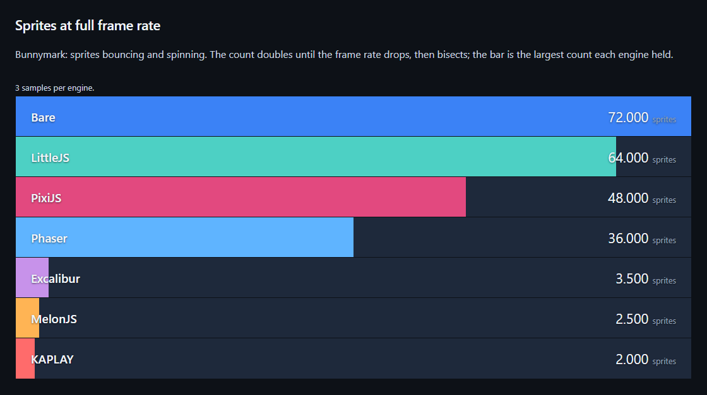
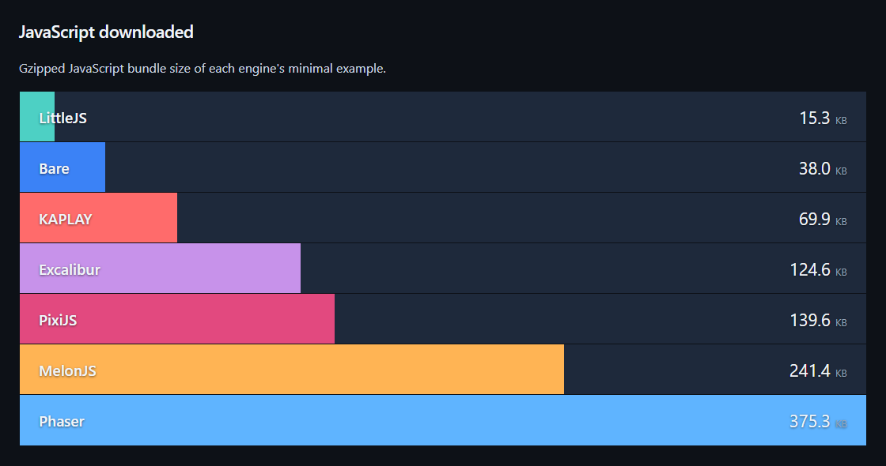

# Web game engine benchmarks

Run `npm install`, then `npm start` and open http://127.0.0.1:4173.

Tested 2026-10-05:

<!-- startup -->

<!-- /startup -->

<!-- performance -->

<!-- /performance -->

<!-- bundle -->

<!-- /bundle -->
